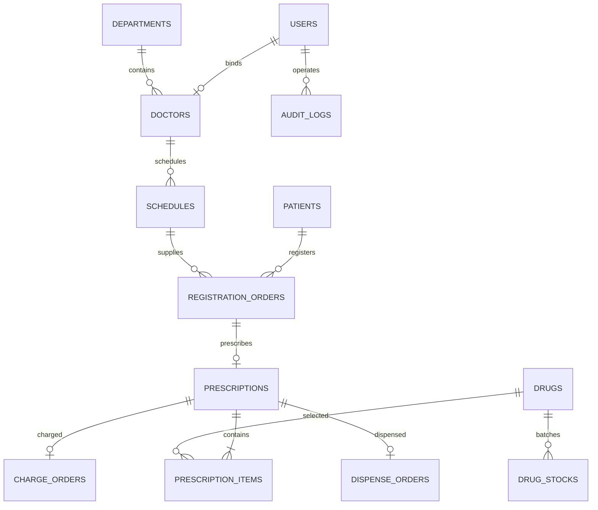

# ER 图与数据字典

| 表 | 主要字段 | 约束/用途 |
|---|---|---|
| users | username,display_name,password_hash,role,status | 用户名唯一；bcrypt；四角色 |
| departments | code,name,status | 编码和名称唯一 |
| doctors | user_id,department_id,name,license_no | 用户/执业号唯一；绑定科室 |
| patients | patient_no,name,id_no_masked,gender,birthday,phone | 编号唯一；身份与电话脱敏 |
| schedules | doctor_id,visit_date,period,total_quota,remain_quota | 医生/日期/时段唯一；0≤余号≤总量 |
| registration_orders | patient_id,doctor_id,schedule_id,queue_no,status,amount,created_by | 排班+排队号唯一；挂号金额0，未接入真实支付 |
| prescriptions | registration_id,doctor_id,diagnosis_code,diagnosis_name,status,total_amount | 每个挂号一张处方；总额定点数 |
| prescription_items | prescription_id,drug_id,quantity,unit_price,dosage,frequency,days | 数量>0；保存开方单价快照 |
| drugs | generic_name,trade_name,specification,dosage_form,insurance_type,unit_price,stock_qty,expiry_date,status | 价格>0、库存≥0；总库存是批次数量汇总镜像 |
| drug_stocks | drug_id,batch_no,quantity,expiry_date | 药品+批号唯一；数量≥0；批次效期决定出库 |
| charge_orders | prescription_id,amount,payer,status,paid_at,created_by | 处方唯一，防重复收费；时间索引 |
| dispense_orders | prescription_id,pharmacist_id,status,dispensed_at | 处方唯一；发药不再扣库存 |
| audit_logs | user_id,action,resource_type,resource_id,before_json,after_json,ip | 时间+ID索引；不记录密码与完整身份文本 |
所有业务表另有 id、created_at、updated_at。时间按UTC保存，统计和界面按北京时间解释。金额 Numeric(12,2)/Decimal，不使用二进制浮点累计。
批次表与药品镜像数量在同一事务中维护；已过期批次保留供追溯，不能发出。

## 数据一致性
SQLite 的写请求先 BEGIN IMMEDIATE，再读取身份与业务状态。这个方案串行化写入，适合单机课程规模。新迁移增加数据库 CHECK 约束；独立连接并发测试验证最后一份资源只有一次成功。
修改旧数据库先备份，Alembic 升级；不采用删除数据库重新建表。
