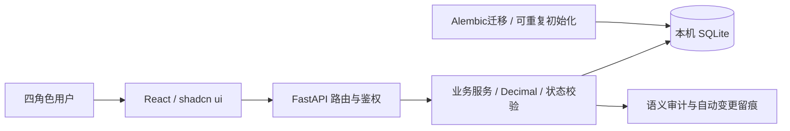

# 基于《医院信息系统基本功能规范》的门诊业务闭环系统设计与实现

项目名称：和序 HIS。实现分支：`dev_lboverfys`。整理日期：2026-10-29。

本报告记录本次实际实现。课程班级、学号、姓名、成员分工和教师要求的封面信息由提交者填写，不代签人工验收。

## 一、选题依据与范围

教师要求：“根据2002医院信息系统功能规范选择题目，完成课程设计的开发。最终需提交项目代码，演示PPT和相关文档。”老师第4～12课分别提供了选题、核心业务、药房收费、认证安全、测试、部署、数据规范、AI伦理与验收指引。

结合初版已有技术与课程规模，选定门诊医生工作站、门诊收费、门诊药房三个分系统的部分功能。患者档案、排班和挂号作为门诊主线支撑。题目目标是让一次门诊业务能连续流转，并留下金额、库存、状态和操作者证据。

用户授权自行选择范围，现场在本机展示，无需公网地址。当前材料主要依据教师课件进行功能主题映射，尚未取得2002年规范全文逐条核验，不编造条款编号，不声称覆盖全部医院信息系统规范。细目见 [需求与验收矩阵](requirements.md)。

明确不包括住院、真实支付与医保结算、完整药库采购盘点、PACS、区域平台、完整ICD字典或生产临床应用。AI为可选辅助，默认关闭，不影响基础业务。

## 二、需求与角色

| 角色 | 主要任务 | 关键边界 |
|---|---|---|
| 挂号收费员 | 患者查询与建档、排班挂号、接诊前取消、核对收费 | 不能开方、发药、改价或查审计 |
| 门诊医生 | 本人待诊、诊断、多个药品明细、草稿编辑、提交 | 不能处理其他医生挂号，不能收费与发药 |
| 药房药师 | 药品与批次入库、核对已收费处方、确认发药 | 不能给未收费处方发药，不能修改药价 |
| 管理员 | 排班、药价、导入、报表、审计、账号启停 | 医生开方仍由医生角色执行，管理员不代替执业身份 |

患者和医生以可读列表选择，操作者无需记忆数据库ID。列表有搜索与分页，提交期间禁用重复操作，成功与失败明确提示。

## 三、总体设计

前端采用React、TypeScript、Vite和shadcn/ui；后端使用FastAPI、Pydantic、SQLAlchemy及Alembic；本机SQLite保存数据。后端提供静态前端文件，现场只启动一个进程、访问一个本地端口。SQLite写入串行化适合小型本机演示，不据此推断生产并发能力。

后端按models、schemas、routers、services划分数据、校验、接口与业务逻辑。前端按pages、components、api划分业务页、组件和请求。前端路由与菜单按角色呈现，后端角色及归属检查承担实际权限控制。

## 四、数据与核心流程

系统包含13张业务表：用户、科室、医生、患者、排班、挂号、处方、处方明细、药品、库存批次、收费单、发药单和审计日志。完整关系及字段见 [ER图与数据字典](er.md)。

挂号状态为“候诊 → 就诊中 → 已完成”；接诊前允许取消并释放号源。挂号不单独收费。排班与排队号联合唯一，号源有非负及不超过总量约束。

处方状态为“草稿 → 待收费 → 已收费 → 已发药”。仅草稿可编辑。创建和编辑时，后端根据药品档案计算Decimal金额，保存单价快照；以后修改档案价格不改变既有处方。以演示药甲12.50元、数量2，药乙3.00元、数量1为例，应付28.00元。

收费先核对状态，再按药品汇总所有明细需求，批量加载药品及批次，按有效期先到期先出。过期批次不参与可用量。收费单、库存、处方状态及审计同一事务提交；任一药不足全部回滚。药师确认发药只更新状态和发药记录，不再次扣库存。数据库唯一约束与状态校验共同阻止重复收费和重复发药。

SQLite写请求在身份查询前取得BEGIN IMMEDIATE写预留，避免先读后写竞争。并发测试使用独立HTTP请求与独立连接，检查最后号源、最后库存和同处方争抢收费时只成功一次。

## 五、界面设计

界面命名“和序 HIS”，使用深青侧栏、浅色工作区、统一指标卡和状态徽章。登录页提供虚构角色快捷填入；工作台展示真实数据库指标与角色快捷入口。

患者、排班、处方、收费和药房页面使用统一筛选、表格、分页、按钮与明细布局。shadcn/ui官方Button、Input、Textarea、NativeSelect、Table、Card、Badge和Skeleton源码已引入项目；来源和适配见 [界面说明](ui-design.md)。桌面双栏，小屏导航横向滚动，表格在自身容器内滚动。

## 六、数据质量、安全与AI

CSV导入限制2MB、5000行，逐行验证价格、数量和日期，返回行号及原因。合法行允许部分成功，无效行不占用去重键；已有药品键按每200个批量查询，重复导入不重复入库。

使用JWT、bcrypt和四角色权限。禁用账号不能登录，已有令牌也不能继续访问；密码变更校验旧密码，并按bcrypt实际字节上限校验新密码。身份证与电话在服务端脱敏，审计不保存密码、令牌或完整身份文本。语义审计记录关键业务动作，自动审计补充非敏感字段变更，并保存操作IP与时间。

本机启动脚本为演示数据目录生成随机JWT密钥；生产模式拒绝默认密钥。默认AI provider关闭，明显身份文本禁止外发；科室候选限制为启用科室，外部调用10秒超时，失败返回“待人工评估”。仅支持教学辅助，不能替代临床诊断。详见 [安全审查](security-review.md) 与 [AI边界](ai-compliance.md)。

## 七、验证、迁移与部署

测试分为纯业务规则、API/数据库集成、浏览器实际主流程。覆盖金额、重复药品、过期批次、回滚、角色与医生归属、并发争抢、迁移、重复初始化、脱敏及AI失败行为。前端检查包含ESLint、TypeScript、Vitest和生产构建。具体命令、数量与证据以 [测试报告](test-report.md) 为准。

数据库由Alembic版本化，不在应用启动时隐式create_all。旧SQLite库升级前备份；可识别初版的未版本化结构，结构不符时停止迁移并保留备份。旧库存回填LEGACY批次。重复seed不恢复已经消耗的库存和号源。

本机执行 `start-demo.ps1`，需要重新构建时加 `-Build`。在浏览器访问 `http://127.0.0.1:8000`；当前终端Ctrl+C停止。项目依赖、缓存、临时与构建均配置D盘。交付包包含web生产文件；新电脑仍需准备Python依赖，不能称为免安装exe。

Docker及CI配置作为可移植补充提供。本机没有Docker CLI，本轮本地验证未取得Docker运行及远程CI通过证据，推送后的CI结果应单独核对。本轮未运行本地Playwright，而由Chrome DevTools进行浏览器操作，避免违反工作区浏览器规则。

## 八、成果、限制与提交准备

本次从已有初版继续完善，保留React/FastAPI技术栈，完成日常可用初始化、业务列表、自动划价、批次库存、安全与并发修复，并重做shadcn/ui界面。交付项目源码、8页答辩PPT、设计说明、测试证据和现场演示脚本。

当前未验证完整规范原文条款、真实外部模型、Docker运行与本分支远程CI；不宣称PostgreSQL生产兼容。截图工具本轮未取得页面图片，浏览器结果与数据库摘要以文字证据记录。无需公网地址。

提交者需要填写班级与成员信息，阅读实现并按 [演示脚本](demo-script.md) 亲自演练。所有AI协作内容在 [开发记录](ai-development-log.md) 如实披露，未生成组员签名、虚构人工审查或课程成绩承诺。

## 参考资料

1. 教师第4～12课PPT，原件保存在项目 `ppt/` 与外部“文档”目录，属于课件，不代替项目答辩PPT。
2. [同学项目初版](https://github.com/aaacnm/hospital-information-system)，本轮基于93bcbea8cc0cdf0f4d4e997bb31dc32d4dab416a继续开发。
3. [shadcn/ui 官方文档](https://ui.shadcn.com/)，New York v4组件registry，MIT许可。
4. FastAPI、SQLAlchemy、Alembic官方文档；2002年规范原文逐条核验仍属未完成资料核验事项。
